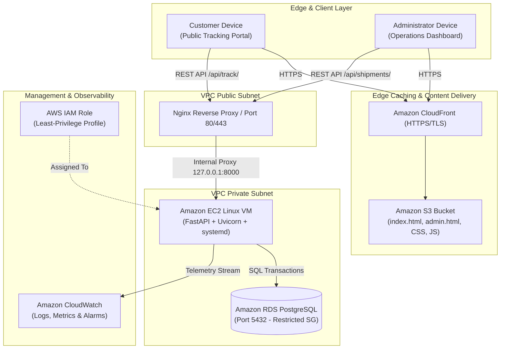
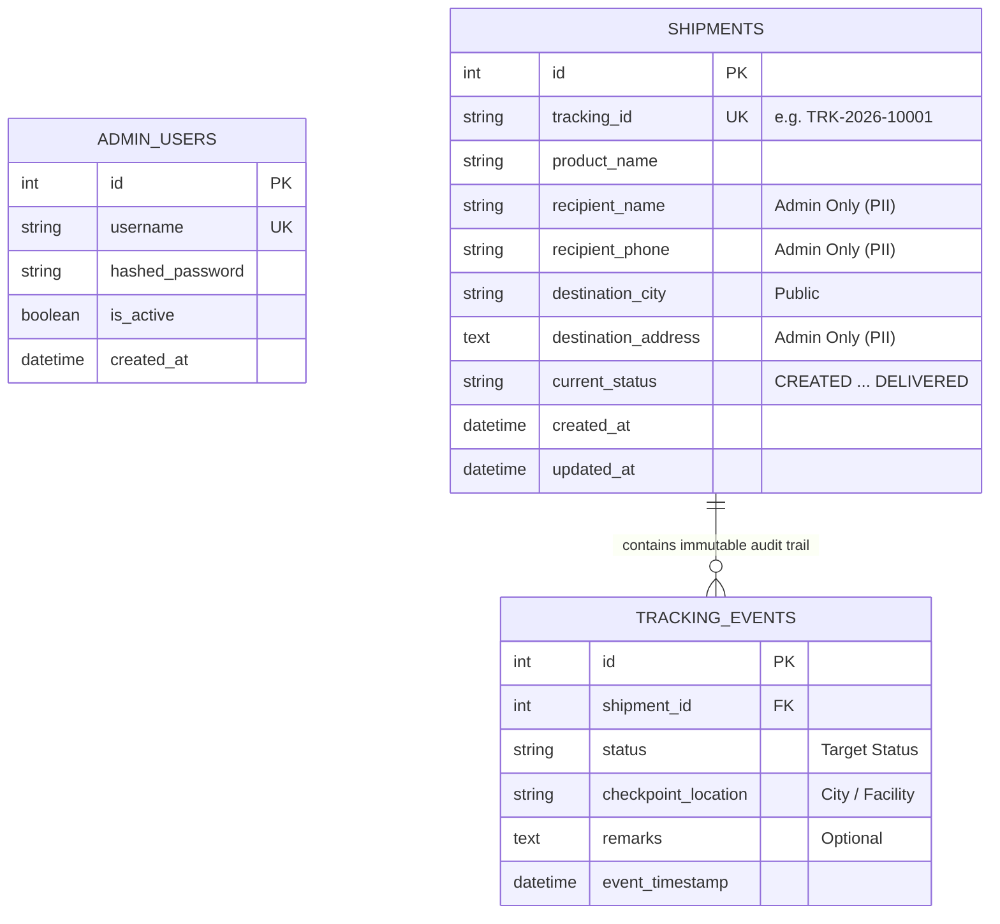
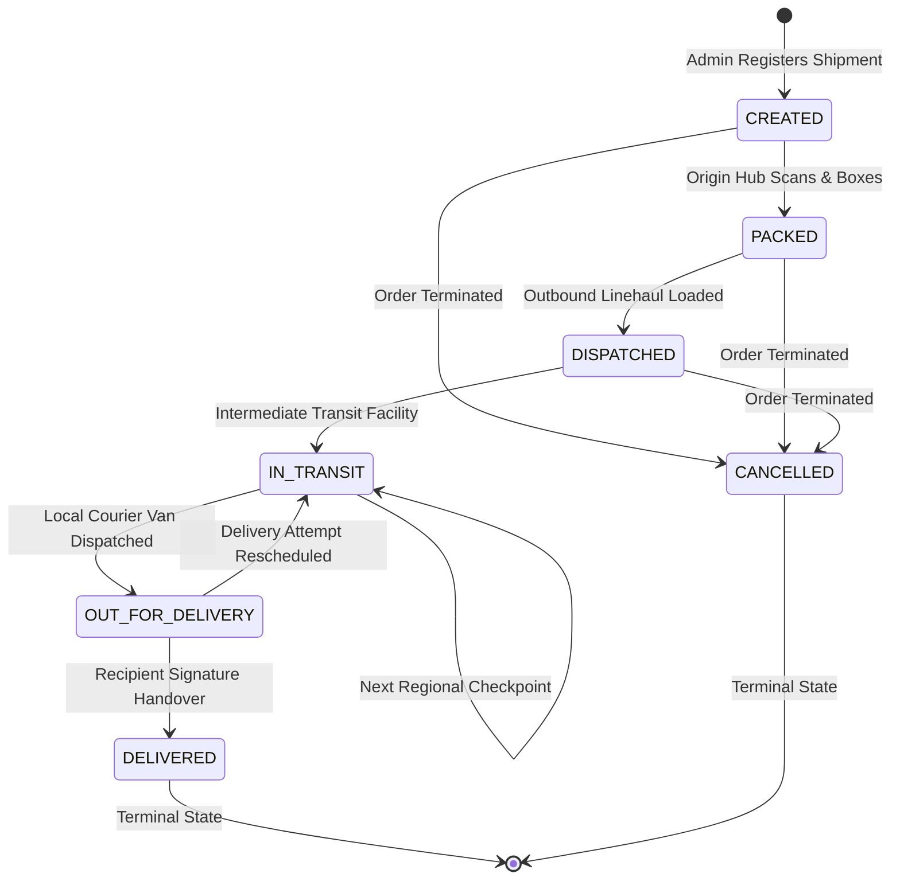

# System Architecture & Technical Specifications

**Project:** Cloud-Based Product Delivery & Real-Time Tracking System  
**Course:** Cloud Computing (Sem 5)

---

## 1. High-Level Cloud Architecture

---

## 2. Database Entity-Relationship Diagram (ERD)

---

## 3. Delivery Lifecycle State Machine

---

## 4. Cloud Security & Privacy Guarantees

1. **Zero Customer PII Exposure:**
   - The public `/api/track/{tracking_id}` endpoint selectively serializes data using `CustomerTrackingResponse`. Fields such as `recipient_name`, `recipient_phone`, and `destination_address` are omitted from the response schema.
2. **Database Isolation:**
   - In AWS, RDS PostgreSQL is deployed without a public IP. Security group `sg-tracking-rds` accepts inbound TCP on port `5432` strictly from `sg-tracking-ec2`.
3. **IAM Least Privilege:**
   - No permanent AWS Access Keys or Secret Keys are stored in configuration files or code. EC2 inherits credentials dynamically via instance profile roles.
4. **Parameterized Queries:**
   - SQLAlchemy ORM parameterizes all SQL queries automatically, preventing SQL injection vulnerabilities.
